# Diagramas propostos do PDV

15 diagramas novos derivados de PDV_ESPECIFICACAO_E_BACKLOG.md v1.0, por solicitação do proprietário em 30/10/2026, no incremento PDV-001. São modelos para revisão: não são os diagramas acadêmicos originais ausentes, nem evidência de implementação ou aprovação de schema/contratos.

[Cópia para revisão no Notion](https://app.notion.com/p/4092c9a99917819c86f4fcd92b288c88).

## Como consultar

Abra o SVG para ampliar sem perder nitidez. Cada arquivo Mermaid é editável e o índice abaixo registra requisitos e limitações. Os três DERs dividem o modelo por assunto; nomes repetidos referenciam o mesmo conceito. O modelo é conceitual: nulabilidade, índices, tipos físicos, estados e cardinalidades finais exigem refinamento antes de migrations. Pagamentos são exclusivamente fictícios e locais.

## Índice

| Diagrama | Imagem vetorial | Fonte editável |
| --- | --- | --- |
| Arquitetura e fronteiras | [SVG](svg/01-arquitetura.svg) | [Mermaid](mermaid/01-arquitetura.mmd) |
| Atores e casos de uso | [SVG](svg/02-casos-de-uso.svg) | [Mermaid](mermaid/02-casos-de-uso.mmd) |
| Classes de domínio | [SVG](svg/03-classes-dominio.svg) | [Mermaid](mermaid/03-classes-dominio.mmd) |
| DER de cadastros e acesso | [SVG](svg/04-der-cadastros-acesso.svg) | [Mermaid](mermaid/04-der-cadastros-acesso.mmd) |
| DER de vendas e estoque | [SVG](svg/05-der-vendas-estoque.svg) | [Mermaid](mermaid/05-der-vendas-estoque.mmd) |
| DER técnico e rastreabilidade | [SVG](svg/06-der-confiabilidade.svg) | [Mermaid](mermaid/06-der-confiabilidade.mmd) |
| Sequência da venda e pagamento fictício | [SVG](svg/07-sequencia-venda.svg) | [Mermaid](mermaid/07-sequencia-venda.mmd) |
| Sequência de cancelamento e compensação | [SVG](svg/08-sequencia-cancelamento.svg) | [Mermaid](mermaid/08-sequencia-cancelamento.mmd) |
| Estados candidatos da venda | [SVG](svg/09-estados-venda.svg) | [Mermaid](mermaid/09-estados-venda.mmd) |
| Estados candidatos do pagamento | [SVG](svg/10-estados-pagamento.svg) | [Mermaid](mermaid/10-estados-pagamento.mmd) |
| Reservas e invariantes de estoque | [SVG](svg/11-estados-reserva.svg) | [Mermaid](mermaid/11-estados-reserva.mmd) |
| Alternativas dos estados de compra | [SVG](svg/12-estados-ordem-compra.svg) | [Mermaid](mermaid/12-estados-ordem-compra.mmd) |
| Estados candidatos de produto e cliente | [SVG](svg/13-estados-cadastros.svg) | [Mermaid](mermaid/13-estados-cadastros.mmd) |
| Alternativas de fornecedor e produto | [SVG](svg/14-fornecedor-produto.svg) | [Mermaid](mermaid/14-fornecedor-produto.mmd) |
| Mensageria e efeitos idempotentes | [SVG](svg/15-outbox-inbox.svg) | [Mermaid](mermaid/15-outbox-inbox.mmd) |

## Decisões preservadas

- DEC-01: estados de venda/pagamento são candidatos; APROVADA versus PAGAMENTO_APROVADO/CONCLUIDA continua sem decisão final. Timeout desconhecido exige reconciliação, não recusa/liberação automática.
- DEC-02: os estados de ordem de compra das seções 7 e 9 são exibidos como duas alternativas, sem equivalência aprovada.
- DEC-03: fornecedor-produto N:1 e N:N são alternativas, sem escolher FK ou tabela final.
- DEC-04: permissões, outbox/inbox, idempotência, comprovantes e controle de projeção são complementos técnicos propostos. Campos técnicos e chaves compostas não constituem schema aprovado.
- DEC-05/06: política de lote/recebimento parcial, bloqueio de cliente e revisão de produto continuam pendentes.
- SRC-01: estes desenhos permitem revisar a baseline textual; não comprovam comparação com originais inexistentes no material acessível. A aceitação da baseline depende do proprietário.

## Vistas e rastreabilidade

### Arquitetura e fronteiras

Requisitos/fontes: RF-A01, RF-A02; RNF05, RNF06, RNF08, RNF10, RNF17, RNF18.

Alvo declarado no pacote, ainda não implementado. PostgreSQL compartilhado é simplificação acadêmica; API e worker são somente dois processos. TLS, réplica e HA não são demonstrados por este desenho.


### Atores e casos de uso

Requisitos/fontes: RF-V01 a RF-V06; RF-E01 a RF-E04; RF-C01 a RF-C04; RF-R01 a RF-R03; RF-A01 e RF-A02.

Representação de casos de uso em flowchart, sem alegar notação UML estrita. A matriz exata de permissões será definida em PDV-013; nenhuma permissão adicional é concedida por este desenho.


### Classes de domínio

Requisitos/fontes: Especificação §7; RF-V01 a V06, RF-C01 a C04, RF-E01 a E04, RF-A01.

As 14 classes citadas no pacote são preservadas. Atributos resumidos e cardinalidades são conceituais; não são entidades ORM. A associação Fornecedor–Produto permanece sem cardinalidade até DEC-03. RBAC físico e entidades técnicas aparecem nos DERs.


### DER de cadastros e acesso

Requisitos/fontes: Especificação §7; RF-A01, RF-C01 a C04, RF-E01; DEC-03 e DEC-04.

Modelo conceitual proposto, não DDL. Nomes e tipos físicos ainda serão padronizados. Permissões e papel-permissão são complementos pendentes em DEC-04. Não se desenha FK fornecedor-produto como decisão já tomada. Unicidades compostas e nulabilidade devem ser refinadas antes de migrations.


### DER de vendas e estoque

Requisitos/fontes: Especificação §7–9; RF-V01 a V06, RF-E02 e E04; RNF03, RNF08, RNF10.

DER conceitual: Produto repete a referência do DER de cadastros. Disponível e reservado são conceitos derivados, sem coluna obrigatória nova. Comprovantes são complemento proposto (DEC-04). Histórico de compras deriva de vendas/itens. Estados e campos físicos finais continuam pendentes.


### DER técnico e rastreabilidade

Requisitos/fontes: Especificação §7–8; RNF06, RNF08, RNF09, RNF17, RNF18; DEC-04.

Todas as estruturas técnicas são propostas, não schema existente. Campos de eventos e chaves compostas são sugestões a aprovar nos contratos. Outbox/inbox e deduplicação pertencem a transações locais; não garantem entrega exatamente uma vez. Relações de entidade_tipo/id são referências lógicas, não FKs para toda tabela.

### Sequência da venda e pagamento fictício

Requisitos/fontes: RF-V01, RF-V02, RF-V03, RF-V06; RNF06, RNF08, RNF10; DEC-01.

Sequência proposta, sem contrato HTTP/evento aprovado. O publicador roda nos processos API/worker, não num terceiro serviço. Retentativas consultam a mesma chave/fingerprint. Resultado desconhecido mantém a reserva até reconciliação; não é sinônimo de recusa.

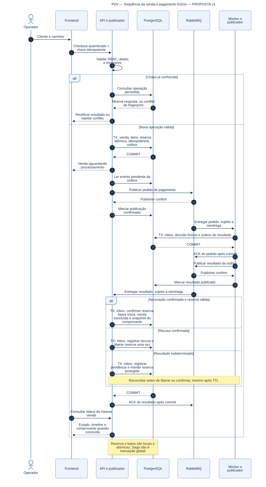

### Sequência de cancelamento e compensação

Requisitos/fontes: RF-V04; RNF06, RNF08, RNF10; DEC-01.

Fluxo proposto para cancelamento pós-aprovação. Cancelamento antes da aprovação depende da definição final da Saga. Não há estorno bancário: apenas simulação local. Falha ou resultado desconhecido não autoriza devolver estoque prematuramente.

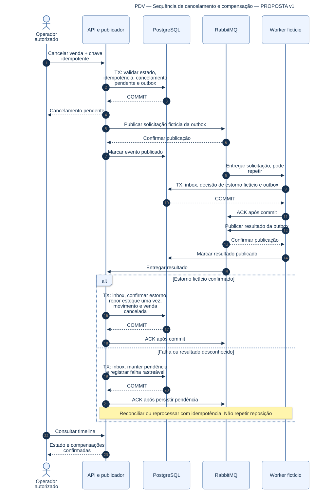

### Estados candidatos da venda

Requisitos/fontes: Especificação §9; RF-V02, RF-V03, RF-V04; DEC-01.

DEC-01 pendente. Usa os nomes candidatos da seção 9, sem declarar enum final. O nome APROVADA de outra descrição continua divergente. Cancelamento antes da confirmação, repetição de tentativa e transições administrativas ainda precisam de refinamento.


### Estados candidatos do pagamento

Requisitos/fontes: Especificação §9; RF-V03, RF-V04; DEC-01.

Somente simulação local. INDETERMINADO representa resultado desconhecido; TIMEOUT é cenário de execução, não recusa automática. Estorno é entidade/processo separado, sem inventar enum final de pagamento.


### Reservas e invariantes de estoque

Requisitos/fontes: RF-V02; RF-E02, RF-E04; RNF03, RNF08, RNF10.

Estados da reserva conforme texto. A elegibilidade segura de expiração precisa de contrato; reserva ligada a resultado incerto/em processamento não é liberada só pelo relógio. O diagrama não cria um enum persistido de estoque nem altera saldo físico ao reservar.


### Alternativas dos estados de compra

Requisitos/fontes: Especificação §7 e §9; RF-C04; DEC-02, DEC-05.

As duas nomenclaturas são apresentadas separadamente para não aprovar uma por omissão. Equivalência de ENVIADA/EM_TRANSITO e tratamento de recebimentos parciais não foram confirmados. Não há transição de retorno de OC recebida inventada.


### Estados candidatos de produto e cliente

Requisitos/fontes: Especificação §9; RF-E01, RF-C01, RF-C02; DEC-06.

Representa a descrição textual, não aprovação de etapas de revisão ou critérios de bloqueio. Transições mínimas de ativação/inativação são candidatas; regras e permissões finais serão definidas nas specs. Inativação não apaga histórico.


### Alternativas de fornecedor e produto

Requisitos/fontes: Especificação §7 e §10; RF-C03; DEC-03.

N:1 é a referência original descrita; N:N é alternativa a avaliar. As duas são possibilidades incompatíveis como decisão final: nenhuma migration/FK é aprovada por este desenho. A seleção depende dos requisitos de compras e catálogo.


### Mensageria e efeitos idempotentes

Requisitos/fontes: RNF06, RNF08, RNF09, RNF10, RNF17; PDV-038; DEC-04.

Entrega ao menos uma vez e efeitos idempotentes, sem promessa de exactly-once. Cada consumidor precisa de inbox por evento+consumidor e efeito na mesma transação local. Política de retry, DLQ, ordenação e contratos será refinada em PDV-007/038.


## Reprodução

Com Node/npm e Chrome/Chromium instalado, executar `./scripts/render-diagrams.ps1` na raiz. O script usa Mermaid CLI 12.0.0 por npm exec no cache de ferramentas; não altera package.json, lockfiles ou dependências de aplicação. Se necessário, definir PUPPETEER_EXECUTABLE_PATH para o navegador local. A opção -Preview também gera PNGs para inspeção em .git/diagrams-preview/, fora do Git. A regeneração substitui apenas as imagens derivadas listadas no manifesto.

Para regenerar um modelo específico, usar `./scripts/render-diagrams.ps1 -Diagram 09-estados-venda -Preview`. Foram renderizados e conferidos os 15 SVGs e as 15 prévias finais; os SVGs também passaram por validação de XML e viewBox. As prévias são apenas material de QA, não fontes originais.

Executar `node scripts/verify-planning.mjs` para conferir a preservação das 60 tarefas, fontes e hashes; isso não prova requisitos implementados. Nenhuma migration ou persistência é criada por estes modelos.

Documentação das ferramentas: [Mermaid CLI](https://github.com/mermaid-js/mermaid-cli), [estados](https://mermaid.js.org/syntax/stateDiagram.html), [DER](https://mermaid.js.org/syntax/entityRelationshipDiagram.html). Fontes do projeto: [pacote original](../sources/PDV_ESPECIFICACAO_E_BACKLOG.md), [reconciliação](../reports/reconciliacao.md), [spec PDV-001](../../sdd/features/PDV-001-auditoria-baseline.md).
